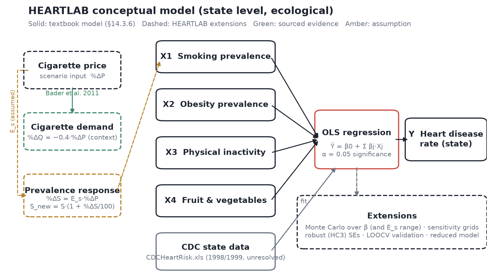
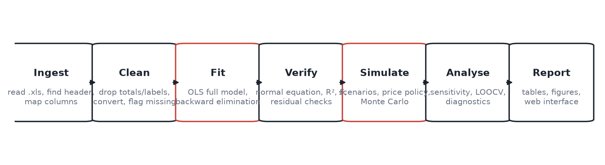
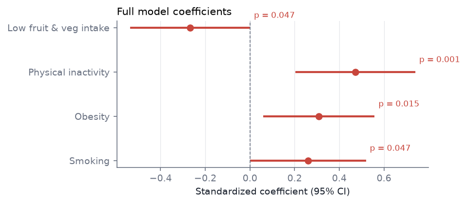
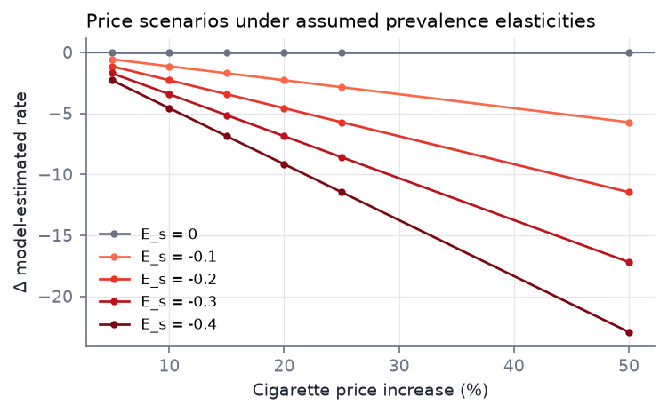
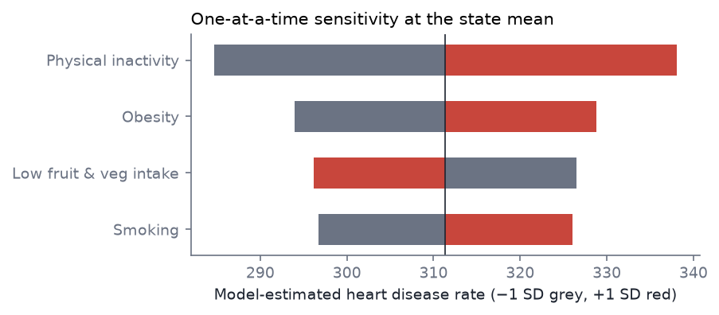
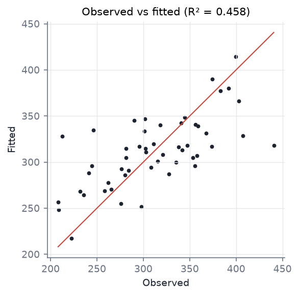

# HEARTLAB: An Interactive Empirical Simulation of Heart Disease Risk Factors

**Research documentation and paper foundation.** Status: methodology, software and empirical results complete on the 1998 state-level dataset `HEARTLAB_1998_CDC_CHD_dataset.csv` (51 jurisdictions).

| Item | Value |
|---|---|
| Course | Computational Science, Final Project |
| Assigned topic | Empirical Model of Heart Disease Risk Factors |
| Primary reference | Gordon & Guilfoos (2017), Chapter 14, Section 14.3.6 |
| Group name and members | **[GROUP INPUT REQUIRED]** |
| Instructor / section | **[GROUP INPUT REQUIRED]** |
| Document version | Results draft (fitted on the 1998 dataset, 26 November 2026) |

> **How to read this document.** Every statement is tagged by its origin where it matters:
> **[Textbook]** = project specification from Gordon & Guilfoos (2017) §14.3.6 and its companion handout, as summarised by the group;
> **[Literature]** = finding reported in a published source;
> **[Assumption]** = a modelling choice introduced by HEARTLAB;
> **[Extension]** = a component added by the HEARTLAB team beyond the textbook model;
> **[Result]** = computed by HEARTLAB from the dataset; every number so tagged is reproduced by `python -m src.run_analysis`.
> The dataset is not the original textbook file `CDCHeartRisk.xls`. It was assembled from separate CDC-published state tables (Section 5.1), so results may differ from any textbook reference answer.

### Mapping to the instructor's required paper structure

The final ACM paper must contain the eight sections required by the project guide. This document is organised into thirteen working sections; the table shows where each one goes.

| Required ACM section (project guide) | Sections in this document |
|---|---|
| 1. Introduction | 1, 2, 3 |
| 2. Conceptual Model of the System | 4.1–4.2 (with Figure 1) |
| 3. Assumptions, Variables, and Relationships | 4.3–4.6, 5 |
| 4. Python Program Code | 6, Appendix A |
| 5. Discussion of Results | 7, 8 |
| 6. Validation, Analysis, and Reporting | 9, 10 |
| 7. Conclusion | 11, 12 |
| 8. Complete References | 13 |

---

## 1. Introduction

Heart disease remains a leading cause of death in the United States, and much of its burden is associated with behaviours that can, in principle, be changed: smoking, excess body weight, physical inactivity, and diet. Public-health agencies therefore monitor both heart disease rates and the prevalence of these behaviours across states. When the two are tabulated side by side, a natural computational question follows: *across states, how strongly is the heart disease rate associated with each behavioural risk factor, and what would a statistical model fitted to those associations estimate if the risk factors changed?*

The assigned project, "Empirical Model of Heart Disease Risk Factors" (Gordon & Guilfoos, 2017, §14.3.6), answers this with an **empirical** model: rather than deriving equations from physiology, it fits a multiple linear regression to observed state-level data supplied by the Centers for Disease Control and Prevention (CDC) and uses the fitted equation to simulate scenarios **[Textbook]**. The central scenario is a cigarette-price increase, which is expected to reduce smoking and, through the fitted equation, the model-estimated heart disease rate **[Textbook]**.

HEARTLAB implements this model in Python and wraps it in an interactive two-screen application so that the model, its assumptions and its outputs can be explored and demonstrated. The application is a teaching and analysis tool for a population-level statistical model. It is not a diagnostic tool and does not simulate an individual's heart.

## 2. Problem Statement and Research Objectives

### 2.1 Statement of the problem

State-level data show variation in heart disease rates and in the prevalence of smoking, obesity, physical inactivity and fruit and vegetable consumption. The problem is to (a) quantify the association between these risk factors and the heart disease rate with a multiple linear regression, (b) determine which associations are statistically significant, and (c) use the fitted model to estimate how the heart disease rate would change under prescribed scenarios, in particular a cigarette-price increase **[Textbook]**.

### 2.2 Objectives of the model

1. Build the empirical model specified in §14.3.6: a multiple linear regression of state heart disease rate on four behavioural risk factors **[Textbook]**.
2. Identify the statistically significant predictors at α = 0.05 using the actual fitted results.
3. Simulate changes in the model-estimated heart disease rate when risk factors are modified one at a time or simultaneously.
4. Simulate a cigarette-price policy, keeping the evidence-supported demand response separate from the assumed smoking-prevalence response **[Textbook + Assumption]**.
5. Test the sensitivity of the estimates to each input and to the policy assumption **[Textbook: project guide goal 4]**.
6. Verify the code and validate the model where possible **[Project guide]**.
7. Relax at least one assumption of the basic model through an added component **[Project guide; Extension]** (Section 7.5).

### 2.3 Research questions

- **RQ1.** How are smoking, obesity, physical inactivity and fruit and vegetable consumption associated with state-level heart disease rates?
- **RQ2.** Which of these factors are statistically significant in the fitted regression?
- **RQ3.** How does the model-estimated heart disease rate change when significant risk factors are modified?
- **RQ4.** What change in the model-estimated rate follows from a cigarette-price increase, under an explicitly stated assumption about its effect on smoking prevalence?
- **RQ5.** How sensitive are the estimates to the inputs, to the coefficient uncertainty, and to the policy assumption?
- **RQ6 (optional, not implemented).** Have heart disease rates and risk factors changed between the original data and 2014–2015 data? (See Section 10.4.)

## 3. Background and Related Literature

### 3.1 Empirical models in the textbook

Chapter 14 of Gordon and Guilfoos (2017) presents capstone projects. One of them, Section 14.3.6, is an empirical model: unlike the first-principles models of other projects in the course list (for example, drug dosage or population dynamics), its form and parameters are estimated from observed data rather than derived from physical laws **[Textbook, as summarised by the group]**.

> **[GROUP INPUT REQUIRED]** Add one or two sentences from Chapter 14 in the group's own words, with page numbers from your copy of the textbook (the group's summary places §14.3.6 on p. 180). The HEARTLAB team could not access the textbook or the companion handout directly (the companion website's security certificate had expired), so this document relies on the project details the group supplied: dataset name, variables, method, policy scenario, Bader et al. reference, optional 2014–2015 extension, and the warning about label and total rows.

### 3.2 Cigarette prices and smoking

Bader, Boisclair and Ferrence (2011) synthesised the evidence on how tobacco taxation and pricing affect smoking in high-risk populations (youth, young adults, low socio-economic status, people with mental-health or substance-use disorders, heavy smokers, and Aboriginal people). Their findings relevant to this project are **[Literature]**:

- In the Introduction they report that, on average, a 10% increase in the price of a pack of cigarettes reduces **demand for cigarettes** by about 4% in the general adult population of high-income countries, citing Jha and Chaloupka (1999). This implies a price elasticity of demand of about **E_d = −4% / 10% = −0.4**.
- Youth are described as two to three times more price-responsive than the general population, but no pooled elasticity is reported.
- The authors conclude that raising cigarette prices through taxation is an effective way to reduce smoking among youth, young adults and low-SES groups, with evidence gaps for other groups.

**Demand is not prevalence.** E_d describes the quantity of cigarettes consumed. The regression uses smoking **prevalence**: the share of adults who smoke. A fall in consumption can come from smokers smoking less as well as from people quitting, so E_d cannot be used as the elasticity of prevalence. Bader et al. (2011) give no general-population prevalence elasticity. HEARTLAB therefore treats the prevalence response as an explicit, user-set assumption (Section 4.5).

### 3.3 Ecological inference

The data are state aggregates. Associations between aggregates need not hold for individuals (Robinson, 1950). A positive coefficient on smoking means that states with higher smoking prevalence tend to have higher heart disease rates, holding the other three measured factors fixed. It does not show that smoking raises any individual's risk by that amount, and the regression alone cannot establish causation. Unmeasured state characteristics, such as age structure, income or access to care, may be correlated with both the predictors and the outcome.

## 4. Model Formulation

### 4.1 System description

The system is the set of U.S. states (and possibly the District of Columbia) observed in one year. Each state has one heart disease rate and four risk-factor measurements. The model treats the heart disease rate as a linear function of the four risk factors plus an error term representing everything the model does not include.

### 4.2 Conceptual model



Figure 1 shows the conceptual model. Four risk factors (X1–X4) enter the OLS regression, which produces the heart disease rate (Y). The policy chain on the left is the price scenario. A cigarette-price change (%ΔP) has a sourced effect on cigarette demand (shown for context only) and an assumed effect on smoking prevalence. Only the prevalence effect changes the regression's smoking input. The extensions box lists the components added to relax the basic model's assumptions.



### 4.3 Variables

| Symbol | Variable (HEARTLAB name) | Role | Unit | Definition |
|---|---|---|---|---|
| Y | CHD death rate (`heart_disease`; column `coronary_heart_disease_age_adjusted_death_rate_per_100k_age_35_plus`) | Dependent | Deaths per 100,000 | Coronary heart disease mortality (ICD-9 410.0–414.9), age-adjusted to the 2000 U.S. standard population, persons aged 35+, 1998 |
| X1 | Current smoking (`smoking`; `current_smoking_percent`) | Predictor; policy input | % of adults | Adults who currently smoke cigarettes, 1998 |
| X2 | Obesity (`obesity`; `obesity_percent_bmi_ge_30`) | Predictor | % of adults | Adults with BMI ≥ 30, 1998 |
| X3 | No leisure-time exercise (`inactivity`; `no_leisure_exercise_percent`) | Predictor | % of adults | Adults reporting no leisure-time physical activity, 1998 |
| X4 | Low fruit and vegetable intake (`fruit_veg`; `less_than_5_fruit_vegetable_servings_percent`) | Predictor | % of adults | Adults eating fewer than five servings of fruit and vegetables a day, 1998. Higher = worse diet, so the plausible sign is positive |
| β0…β4 | Regression coefficients | Parameters | Units of Y per unit of X | Estimated by OLS |
| ε | Error term | Random | Units of Y | Unexplained state-level variation |
| %ΔP | Cigarette price increase | Scenario input | % | Set by the user, 0–100% |
| E_d | Price elasticity of cigarette demand | Sourced constant | dimensionless | −0.4 (Bader et al., 2011) |
| E_s | Price elasticity of smoking prevalence | **Assumption** | dimensionless | Set by the user, −1 to 0; default 0 |

Column headers, units and definitions are recorded in `config/column_mapping.json`, taken from the dataset's own column names and its `outcome_definition` column. Note that X4 measures *inadequate* intake, the inverse of the textbook's wording "fruit and vegetable consumption".

### 4.4 Equations

**Regression model [Textbook].** For state *i*:

> Y_i = β0 + β1·X1_i + β2·X2_i + β3·X3_i + β4·X4_i + ε_i     (1)

**OLS estimator.** With design matrix **X** (a column of ones plus the four predictors) and outcome vector **y**:

> β̂ = (XᵀX)⁻¹ Xᵀy     (2)

**Fitted value / scenario estimate.** For an input vector x = (1, x1, x2, x3, x4):

> Ŷ(x) = xᵀβ̂     (3)

**Scenario difference and its uncertainty.** For a baseline x_b and scenario x_s, with d = x_s − x_b:

> ΔŶ = dᵀβ̂,   SE(ΔŶ) = √(dᵀ Cov(β̂) d),   95% CI = ΔŶ ± t(0.975, n−k−1)·SE     (4)

**Relative difference** (meaningful because rates are positive): 100·ΔŶ / Ŷ(x_b).

**Policy Component A, demand (sourced) [Literature]:**

> %ΔQ = E_d · %ΔP,  E_d = −0.4     (5)

**Policy Component B, prevalence (assumption) [Assumption]:**

> %ΔS = E_s · %ΔP,   S_new = S_base · (1 + %ΔS / 100)     (6)

**Policy Component C, regression outcome [Textbook + Assumption]:** equation (4) with d = (0, S_new − S_base, 0, 0, 0), which gives ΔŶ = β̂1·(S_new − S_base).

**Model fit statistics.** R² = 1 − SSE/SST; adjusted R² = 1 − (1 − R²)(n − 1)/(n − k − 1); F = (R²/k) / ((1 − R²)/(n − k − 1)) with k = 4 predictors.

### 4.5 Explanation of the relationships

- Each β_j is the expected difference in state heart disease rate between two states that differ by one unit in X_j and are equal in the other three predictors. The sign gives the direction of the association and the p-value tests H0: β_j = 0.
- The price policy affects the model **only through X1**. Price is not a regression variable, so its modelled effect is entirely the product of the assumed prevalence response (6) and the fitted smoking coefficient β̂1. If smoking is not in the model used, for example after backward elimination, the model gives the price policy no effect.
- E_d (−0.4) is displayed so that readers see the evidence. It is **never** substituted for E_s. With the default E_s = 0, a price increase leaves smoking prevalence and the model estimate unchanged. The user must choose an assumption to see an effect, and the interface labels it as an assumption.
- The sensitivity analysis spans E_s from 0 (no prevalence response) to −0.4 (prevalence falling as fast as total demand). The upper end is a deliberately generous bound, not an estimate.

### 4.6 Assumptions

| # | Assumption | Origin | Relaxed or examined by |
|---|---|---|---|
| A1 | The heart disease rate is linear and additive in the four risk factors | Textbook | Residual-vs-fitted plot; one-at-a-time sensitivity |
| A2 | Errors are independent with constant variance (homoscedastic) | OLS | Breusch–Pagan and White tests; HC3 robust standard errors **[Extension]** |
| A3 | Errors are approximately normal (for exact t- and F-inference) | OLS | Jarque–Bera and Shapiro–Wilk tests; Q–Q plot |
| A4 | Predictors are not strongly collinear | OLS | Variance inflation factors |
| A5 | No single state drives the fit | OLS | Cook's distance and leverage |
| A6 | Coefficients are known exactly when simulating | Basic model | **Relaxed:** confidence intervals for ΔŶ and Monte Carlo propagation of Cov(β̂) **[Extension]** |
| A7 | A price change acts on heart disease only through smoking prevalence | Textbook scenario design | Stated explicitly; Component C |
| A8 | The prevalence response to price is E_s·%ΔP (constant elasticity, relative change) | **Assumption** | **Relaxed:** user-set E_s, policy grid over E_s ∈ {0, −0.1, −0.2, −0.3, −0.4}, Monte Carlo with E_s ~ Uniform(range) **[Extension]** |
| A9 | Other risk factors are unchanged when one is varied (ceteris paribus) | Scenario design | User can change several simultaneously |
| A10 | The cross-sectional association applies to within-state change | Ecological / causal | Not testable with these data; stated as a limitation |
| A11 | States are equally weighted (unweighted OLS; baseline = unweighted mean of states) | Implementation | Documented; population weighting is possible future work |
| A12 | Missing values are handled by listwise deletion | Implementation | Number of complete cases reported |

## 5. Data Description and Preprocessing

### 5.1 Data source

| Field | Value |
|---|---|
| File | `data/raw/HEARTLAB_1998_CDC_CHD_dataset.csv` (SHA-256 `a9335199…b0d472e`) |
| Provenance | Assembled from separate CDC-published state tables. The file's own `source_status` column reads `assembled_from_separate_CDC_published_tables_not_original_CDCHeartRisk.xls`. It is **not** the textbook's `CDCHeartRisk.xls`. |
| Coverage | 50 states and the District of Columbia (51 jurisdictions); no territories, no national total row |
| Unit of analysis | State (aggregate) |
| Year | Risk factors: 1998 (`risk_factor_year`). Outcome: 1998 (`outcome_year`). Both read from the file itself. |
| Outcome definition | "Coronary heart disease mortality; ICD-9 410.0-414.9; age-adjusted, persons aged 35+, standardized to 2000 US population" (file column `outcome_definition`) |
| Variables | Section 4.3 |

> **Year discrepancy.** The textbook describes its `CDCHeartRisk.xls` as 1999 data and the companion handout as 1998. That discrepancy concerns the original spreadsheet. The dataset used here is internally consistent: both the risk factors and the CHD outcome are 1998.

> **[GROUP INPUT REQUIRED]** Record the specific CDC tables (and access dates) from which each column was assembled, e.g. the Behavioral Risk Factor Surveillance System prevalence tables for X1–X4 and the CDC mortality tables for Y.

### 5.2 Known data-handling issue

The handout warns that the spreadsheet contains extra labels and a total that must not be used as observations **[Textbook]**. HEARTLAB handles this in `src/data_processing.py`:

1. **Locate the header row.** Every sheet is read without headers. The header row is the row (among the first 40) whose cells name the most model variables, and at least three must match. It can also be set explicitly with `header_row`.
2. **Map columns.** Each model variable is matched to a header by an explicit name in `config/column_mapping.json` or, failing that, by case-insensitive patterns (for example `smok`, `obes`, `inactiv`, `fruit`). If a variable matches no column, or more than one, ingestion stops and lists the headers found. Column positions are never assumed.
3. **Classify rows.** A row is an observation only if its label is a recognised state name or postal abbreviation (DC configurable; territories excluded by default). Totals, "United States", averages, medians, notes and blank labels are excluded, and each exclusion is recorded with its row number and reason.
4. **Convert values.** Numbers, numeric text, and text with `%` or thousands separators are converted. Blank cells, `NA`, `N/A`, `-` and `.` are treated as missing. Other text is flagged as non-numeric. Each problem is logged with its row, state and variable.
5. **Check plausibility.** Duplicate states abort ingestion. Negative prevalence and prevalence above 100 raise warnings. The scale (percent or proportion) is detected and reported, not silently rescaled.
6. **Missing values.** The regression uses complete cases (listwise deletion, A12). The number of complete cases and the absent states are reported.
7. **Outputs.** `data/processed/heart_risk_clean.csv` and `data/processed/ingestion_report.json`.

**Results on the dataset [Result].** 51 rows scanned; all 51 recognised as jurisdictions (50 states + DC); 0 rows excluded; 0 missing or non-numeric values; 51 complete cases. All five model columns and the state column were matched by their configured exact names (`known_headers`), and all four predictors are on a 0–100 percent scale (`data/processed/ingestion_report.json`).

### 5.3 Descriptive statistics

**Table 2. Descriptive statistics, n = 51 [Result]** (`results/tables/descriptive_statistics.csv`).

| Variable | Mean | SD | Min | Median | Max |
|---|---|---|---|---|---|
| CHD deaths per 100,000 | 311.36 | 56.57 | 208.1 | 308.2 | 440.6 |
| Current smoking (%) | 23.21 | 2.97 | 14.2 | 22.9 | 30.8 |
| Obesity (%) | 18.11 | 2.50 | 13.1 | 18.3 | 23.9 |
| No leisure-time exercise (%) | 28.81 | 7.21 | 17.1 | 27.7 | 51.3 |
| Low fruit/veg intake (%) | 76.53 | 4.53 | 68.1 | 76.2 | 90.9 |

**Table 3. Pearson correlations [Result]** (`results/tables/correlation_matrix.csv`).

| | CHD | Smoking | Obesity | Inactivity | Low fruit/veg |
|---|---|---|---|---|---|
| CHD | 1 | 0.463 | 0.466 | 0.498 | 0.155 |
| Smoking | | 1 | 0.431 | 0.349 | 0.350 |
| Obesity | | | 1 | 0.251 | 0.270 |
| Inactivity | | | | 1 | 0.528 |
| Low fruit/veg | | | | | 1 |

Each risk factor is positively correlated with the CHD death rate on its own. The strongest correlation among predictors is between inactivity and low fruit/vegetable intake (0.53).

## 6. Computational Methodology

### 6.1 Architecture

| Layer | Files | Responsibility |
|---|---|---|
| Data | `src/data_processing.py`, `config/column_mapping.json` | Excel/CSV import, header detection, column mapping, row classification, conversion, validation report |
| Statistics | `src/model.py` | OLS fit (statsmodels), normal-equation check, inference, HC3, VIF, Breusch–Pagan, White, Jarque–Bera, Shapiro–Wilk, Cook's distance, prediction and difference intervals, backward elimination |
| Simulation | `src/simulation.py` | Input validation and bounds, baselines, policy Components A–C, scenario runs, Monte Carlo |
| Sensitivity | `src/sensitivity_analysis.py` | One-at-a-time grid, tornado, price × elasticity grid |
| Verification/validation | `src/validation.py` | Analytic identity checks, LOOCV (PRESS), sign plausibility |
| Orchestration | `src/engine.py`, `src/run_analysis.py` | State A/B logic; batch generation of all tables and figures |
| Web backend | `app/backend/server.py` (FastAPI) | JSON API; the interface performs no statistical calculation |
| Interface | `app/frontend/` (HTML/CSS/JavaScript, SVG charts) | Landing screen and simulation screen |

Libraries: pandas, NumPy, SciPy, statsmodels, matplotlib, FastAPI. Exact versions are listed in `requirements.txt`.

### 6.2 Estimation and inference

- OLS with an intercept via `statsmodels.OLS`. Coefficients, standard errors, t-statistics, two-sided p-values and 95% confidence intervals are reported, along with R², adjusted R², the overall F-test, residual standard error, AIC and BIC.
- **Significance level** α = 0.05 (two-sided). A predictor is called significant only if its fitted p-value is below 0.05. "Significant" means the data are unlikely under β_j = 0, given the model assumptions. It says nothing about effect size or causation.
- **Full model first.** The four-predictor candidate model specified by the textbook is always fitted and reported. A **reduced model** is then found by backward elimination: repeatedly drop the predictor with the largest p-value above 0.05 and refit. It is reported alongside the full model, never instead of it. Both are selectable in the interface. Because elimination is data-driven, the p-values of the reduced model are optimistic, and the paper should treat the full model as primary.
- **Robustness [Extension].** HC3 heteroskedasticity-consistent standard errors (MacKinnon & White, 1985) are reported next to the classical ones.
- **Diagnostics.** VIF for each predictor; Breusch–Pagan and White tests; Jarque–Bera and Shapiro–Wilk tests on residuals; externally studentised residuals (|t| > 2.5 flagged); leverage (> 2(k+1)/n flagged); Cook's distance (> 4/n flagged).

### 6.3 Interfaces between the layers

The browser sends inputs to `POST /api/simulate`. The backend validates them, computes all estimates and returns JSON, which the browser draws. Endpoints: `GET /api/status`, `GET /api/model`, `GET /api/baseline`, `POST /api/simulate`, `GET /api/sensitivity`, and `POST /api/dataset` (upload, validated before it is saved).

## 7. Simulation Design

### 7.1 Baseline

The baseline input vector is either the unweighted mean of the four risk factors across the complete-case states (default) or the observed values of a single selected state. The baseline estimate is Ŷ(x_b) from the fitted model; for the mean baseline, an OLS property guarantees Ŷ(x̄) = ȳ.

### 7.2 Scenario types

1. **Single-factor change.** One input is moved and the others are held at baseline.
2. **Simultaneous change.** Several inputs are moved together. Because the model is linear, ΔŶ is the sum of the per-factor contributions β̂_j·Δx_j, which the interface shows.
3. **Price policy.** %ΔP and E_s set the new smoking input by equation (6). Any manual smoking change is applied first, and the policy acts on that value.
4. **Reset.** Restores the selected baseline and sets the price change and E_s to 0.

### 7.3 Input validation

The backend rejects non-numeric, non-finite and physically impossible values: prevalence below 0 or above 100 (or 1 for proportions), price outside 0–100%, and E_s outside [−1, 0]. Interface sliders span the observed state range ±25%. Values outside the observed range are accepted but flagged as extrapolation.

### 7.4 Outputs per run

Baseline and scenario estimates, each with a 95% confidence interval (mean response) and 95% prediction interval (a new state); the absolute difference with its 95% CI; the relative difference; per-factor contributions; the full policy chain, with sourced and assumed values labelled; extrapolation warnings; and the Monte Carlo summary.

### 7.5 Additional component that relaxes assumptions [Extension]

The basic model treats the fitted coefficients as exact and has no stated link from price to prevalence. HEARTLAB relaxes both:

- **Coefficient uncertainty (relaxes A6).** The exact interval in equation (4), plus a Monte Carlo simulation: 5,000 draws of β from N(β̂, Cov(β̂)) with a fixed seed (20171), so results are reproducible.
- **Policy-response uncertainty (relaxes A8).** E_s is user-set and can also be treated as uncertain: in each Monte Carlo draw E_s ~ Uniform(lo, hi), which propagates both sources of uncertainty into ΔŶ. The output reports the mean, SD, quantiles (2.5–97.5%) and the share of draws with ΔŶ < 0.
- **Heteroskedasticity-robust inference (relaxes A2).** HC3 standard errors.

### 7.6 Prescribed scenario sets (for the paper)

| Set | Scenarios |
|---|---|
| S1: single factors | Each predictor at −2, −1, −0.5, +0.5, +1, +2 SD and at −5, −2, −1, +1, +2, +5 percentage points from the state mean |
| S2: tornado | Each predictor at −1 SD and +1 SD |
| S3: price policy | %ΔP ∈ {5, 10, 15, 20, 25, 50} × E_s ∈ {0, −0.1, −0.2, −0.3, −0.4} |
| S4: combined | Example run in the interface: 20% price rise with E_s = −0.2 plus obesity lowered from 18.11% to 16% (Section 8.4) |
| S5: state baselines | Any state can be chosen in the interface; **[GROUP INPUT]** pick 2–3 for the paper (e.g. New York, highest observed rate, and New Mexico, lowest) |

## 8. Results and Discussion

All numbers in this section are **[Result]** values computed by HEARTLAB from the 1998 dataset (n = 51) and written by `python -m src.run_analysis` to `results/`.

### 8.1 Fitted model

> Ŷ = 219.95 + 4.940·Smoking + 6.977·Obesity + 3.702·Inactivity − 3.348·LowFruitVeg

**Table 4. Full model, OLS (`results/tables/coefficients_full.csv`).**

| Term | Estimate | SE | t | p | 95% CI | p (HC3) | Standardized β* |
|---|---|---|---|---|---|---|---|
| Intercept | 219.948 | 112.829 | 1.95 | 0.057 | −7.16 to 447.06 | 0.058 | – |
| Smoking | 4.940 | 2.414 | 2.05 | 0.047 | 0.08 to 9.80 | 0.108 | 0.259 |
| Obesity | 6.977 | 2.757 | 2.53 | 0.015 | 1.43 to 12.53 | 0.043 | 0.308 |
| Inactivity | 3.702 | 1.027 | 3.61 | < 0.001 | 1.64 to 5.77 | 0.002 | 0.472 |
| Low fruit/veg | −3.348 | 1.640 | −2.04 | 0.047 | −6.65 to −0.05 | 0.032 | −0.268 |

Fit: R² = 0.458, adjusted R² = 0.410, F(4, 46) = 9.70, p < 0.001; residual SE = 43.44 deaths per 100,000; AIC 534.1, BIC 543.8.



### 8.2 Interpretation

- **All four predictors are significant at α = 0.05** in the full model, so backward elimination removes none and the reduced model is the full model.
- **Inactivity has the strongest and most robust association** (β* = 0.47; p < 0.001; p = 0.002 with HC3). A state with 1 percentage point more adults reporting no leisure-time exercise has, on average, 3.7 more CHD deaths per 100,000 at equal smoking, obesity and diet.
- **Obesity** is next: +6.98 per percentage point (β* = 0.31), significant under both classical and robust errors.
- **Smoking** is positive (+4.94 per point) but marginal: p = 0.047, with a lower CI bound close to zero (0.08), and **not significant under HC3 robust errors (p = 0.108)**. Price-scenario results, which act only through smoking, therefore rest on the least robust coefficient.
- **Low fruit/vegetable intake has a negative partial coefficient** (−3.35, p = 0.047), the opposite of the plausible direction, even though its simple correlation with CHD is positive (0.155). Its correlation with inactivity (0.53) points to a suppression effect: once inactivity is held fixed, the remaining variation in the diet measure is associated with lower CHD mortality. This should be reported as a statistical association that conflicts with the expected sign, not as evidence that a poorer diet is protective. HEARTLAB's sign check flags it.
- The four factors together explain about 46% of the between-state variance in CHD mortality. The rest reflects factors outside the model (age structure, income, health care, geography) and noise.
- All statements are cross-sectional associations between states in 1998 and do not describe causal effects or individuals.

### 8.3 Price scenarios

**Table 5. Change in the estimated CHD death rate at the state mean, by price increase and assumed prevalence elasticity E_s [Result]** (`results/tables/sensitivity_policy_grid.csv`; 95% CI in brackets).

| Price increase | Demand change (E_d = −0.4) | E_s = −0.1 | E_s = −0.2 | E_s = −0.4 |
|---|---|---|---|---|
| +10% | −4.0% | −1.15 [−2.28, −0.02] | −2.29 [−4.55, −0.04] | −4.59 [−9.10, −0.07] |
| +20% | −8.0% | −2.29 [−4.55, −0.04] | −4.59 [−9.10, −0.07] | −9.17 [−18.20, −0.15] |
| +50% | −20.0% | −5.73 [−11.37, −0.09] | −11.47 [−22.75, −0.19] | −22.93 [−45.49, −0.37] |

With E_s = 0 (the default), no price increase changes the estimate. The estimate scales with the product E_s × %ΔP, so a 20% rise with E_s = −0.2 gives the same result as a 10% rise with E_s = −0.4. For context, the mean baseline is 311.36. Every interval's upper bound lies just below zero, which mirrors the marginal smoking coefficient. The Monte Carlo propagation (5,000 draws) for 20% × −0.2 gives a median of −4.57 with 98.1% of draws below zero.



### 8.4 Combined scenario example

A 20% price rise with E_s = −0.2 (smoking 23.21% → 22.28%), together with obesity reduced from 18.11% to 16.00%, moves the mean-baseline estimate from 311.4 to 292.1, a change of −19.28 (95% CI −30.20 to −8.36). Of this, −4.59 is attributed to smoking and −14.69 to obesity. This was run in the HEARTLAB interface; the numbers come from the backend.

### 8.5 Result files

| Output | File |
|---|---|
| Ingestion report | `data/processed/ingestion_report.json`, `results/tables/excluded_rows.csv` |
| Descriptive statistics, correlations | `descriptive_statistics.csv`, `correlation_matrix.csv` |
| Coefficients, VIF, residuals, verification | `coefficients_full.csv`, `vif_full.csv`, `residuals_full.csv`, `verification_full.csv` |
| Full summary | `results/model_summary.json` |
| Figures | `results/figures/fig1`–`fig6` |

## 9. Sensitivity Analysis

The sensitivity framework is implemented and tested (Section 10.1). With real data it produces:

1. **One-at-a-time (scenario set S1).** ΔŶ and its 95% CI for each predictor shift. Because the model is linear, ΔŶ equals β̂_j·Δx_j exactly. The analysis therefore puts the coefficients on comparable scales (per SD) and shows how far each lies from zero, given its CI.
2. **Tornado (S2).** The swing in Ŷ from −1 SD to +1 SD of each predictor, ranked. This equals 2·|β̂_j|·SD_j and is the unstandardised counterpart of the standardised coefficients.
3. **Policy grid (S3).** ΔŶ for each price and elasticity combination. Because ΔŶ = β̂1·S_base·E_s·%ΔP/100, the policy result is proportional to the product E_s·%ΔP. **The assumption matters as much as the price change**, which is why E_s is exposed and varied rather than fixed.
4. **Monte Carlo (Section 7.5).** The spread of ΔŶ due to coefficient uncertainty alone, and with E_s uncertainty added.

Every table row records whether each value is observed (baseline), user-defined (scenario) or assumed (E_s).

**Results [Result].** The tornado ranks the factors by the swing in the estimate from −1 SD to +1 SD at the state mean: inactivity 53.4 (284.6 to 338.1), obesity 34.9, low fruit/veg 30.4 (in the negative direction), smoking 29.3 deaths per 100,000. Smoking, the only factor the price policy acts on, has the smallest one-SD swing. The policy grid is Table 5.



## 10. Verification and Validation

### 10.1 Verification (is the code correct?)

**Analytic checks run on every fit** (`src/validation.py`; shown in the interface):

| Check | Criterion |
|---|---|
| statsmodels β̂ equals the NumPy solution of (XᵀX)β = Xᵀy | Relative tolerance 1e-8 |
| R² equals 1 − SSE/SST | Absolute difference < 1e-8 |
| F equals (R²/k)/((1 − R²)/(n − k − 1)) | Relative tolerance 1e-6 |
| p(F) from the F distribution matches statsmodels | Difference < 1e-10 |
| Residuals sum to zero (model has an intercept) | Within numerical tolerance |
| Ŷ at the predictor means equals the mean of Y | Within numerical tolerance |

**Automated test suite.** 104 tests passed and none were skipped on 26 November 2026 (`pytest`), including the real-data integration tests. The fixtures are **synthetic**: spreadsheets generated from a known linear model with a fixed seed and deliberately messy layout (title rows, a total row, a note row, missing cells, numbers written as text). They test the software only and are not CDC data. A loaded synthetic file is detected and flagged in the interface and the analysis runner, and is never written into `results/` or `data/raw/`.

| Area | What the tests establish |
|---|---|
| Ingestion | Header row found below label rows; mapping by pattern and by explicit header; missing and ambiguous headers rejected; Total, "United States", median, note and blank rows excluded with reasons; DC and territory handling; `%` and thousands-separator text converted; missing and non-numeric values flagged; listwise deletion (51 rows read, 48 complete in the fixture); duplicate states rejected; .xls, .xlsx and .csv inputs |
| Model | Exact recovery of the generating coefficients (40, 6, 3, 0, −1.5) from noise-free data to 1e-6; statsmodels equals the normal equation; t = β̂/SE; CIs contain the estimates; significance flags match p < 0.05; the true-zero predictor is not significant and is dropped first by backward elimination; prediction intervals contain confidence intervals |
| Verification and validation | All analytic checks pass; the hat-matrix LOOCV shortcut equals brute-force refitting n times |
| Policy | Demand changes for 5/10/15/20% equal −2/−4/−6/−8%; prevalence uses E_s, never E_d; zero elasticity gives zero change; boundary values accepted; out-of-range, NaN, infinite and non-numeric inputs rejected |
| Scenarios | Baseline gives zero difference; single-factor ΔŶ = β̂_j·Δx; simultaneous changes are additive; price flows into smoking (S·0.98 for 10% × −0.2); the reduced model ignores dropped variables; state baselines; reset; identical inputs give identical outputs, including the seeded Monte Carlo; the Monte Carlo mean and SD match the analytic ΔŶ and SE; extrapolation flagged |
| Sensitivity | Tornado swing = 2·|β̂|·SD; grid size and labels; zero-elasticity rows are zero |
| API | Frontend assets served; State A returns no regression output; State B returns model and simulation; outputs recomputed when inputs change; invalid requests return HTTP 422; bad uploads rejected; synthetic uploads not persisted |
| Browser (headless Chromium) | Landing → workspace navigation; synthetic-data banner shown; changing a factor marks results stale and the re-run changes the estimate; simultaneous changes; reset returns the baseline estimate; pathway shows −8.0% demand and −6.0% prevalence for 20% × −0.3; invalid price shows an error; without a dataset the run button is disabled and only the upload component is shown; upload rejects a wrong file type and loads a valid file; keyboard-operable model tabs; no horizontal overflow at 390 px and a one-viewport landing |
| Real dataset | All five columns mapped by configured names; 50 states + DC, complete, nothing excluded; file years 1998; coefficients equal an independent NumPy least-squares solution; API in State B; price pathway arithmetic; browser shows the backend's estimate |

### 10.2 Validation (does the model describe the system?)

The data form a single cross-section, so no independent test set exists. HEARTLAB uses:

- **Leave-one-state-out cross-validation.** Prediction error for each state when it is left out of the fit, computed exactly with e_i/(1 − h_ii) and checked against brute-force refitting. Reports PRESS, LOOCV RMSE, LOOCV MAE and predicted R², compared with the in-sample RMSE and R². A large gap indicates overfitting or influential states.
- **Plausibility of signs.** Smoking, obesity, inactivity and low fruit/vegetable intake are all expected to show positive associations (`expected_sign` in the mapping file). Agreement is a plausibility check, not a validation of causal effects.
- **Diagnostics** for assumptions A2–A5 (Section 6.2).
- **External comparison [GROUP INPUT / PENDING].** If the instructor or textbook gives reference answers for §14.3.6, compare coefficients and R² directly. That would be the strongest available validation of the implementation on the real data.

**Results [Result].**

- *Verification:* all six analytic checks pass (`results/tables/verification_full.csv`).
- *LOOCV:* in-sample RMSE 41.25 vs LOOCV RMSE 45.80 (MAE 35.51); predicted R² = 0.331 vs R² = 0.458. The model loses some accuracy out of sample, as expected with n = 51 and five parameters, but keeps about a third of the variance.
- *Signs:* smoking, obesity and inactivity agree with the expected positive sign; low fruit/vegetable intake does not (Section 8.2).
- *Variance:* Breusch–Pagan LM = 0.80 (p = 0.939) and White LM = 8.38 (p = 0.868); constant variance is not rejected.
- *Normality:* Jarque–Bera = 2.22 (p = 0.330) and Shapiro–Wilk W = 0.983 (p = 0.685); not rejected.
- *Collinearity:* VIFs 1.26–1.46; no concern.
- *Influence:* six jurisdictions exceed at least one threshold. Cook's D > 4/n = 0.078: Nevada (0.222), Alaska (0.157), Arizona (0.120), DC (0.119), New York (0.090). Outliers |t| > 2.5: New York (+3.17, observed 440.6 vs fitted 318.0) and Alaska (−3.03, 212.4 vs 328.0). High leverage: Arizona (0.506), Nevada (0.344), Utah (0.230). All remain in the fit; the group may report a sensitivity refit without them.
- *External comparison:* not possible, because the dataset is not the textbook file.



### 10.3 What validation cannot establish

No analysis of these data can validate the causal claim that changing a state's smoking prevalence would change its heart disease rate by β̂1 per point, or that a price increase would produce the assumed prevalence response. Those are modelling assumptions and are labelled as such.

### 10.4 Optional temporal comparison (2014–2015) — not implemented

The handout proposes rebuilding the model with 2014–2015 data and comparing it with the original **[Textbook]**. This was **not** implemented, because no comparable 2014–2015 dataset has been obtained. The ingestion pipeline will accept such a file (it is not specific to one year), but a valid comparison would also need to check the points below. The BRFSS weighting method changed in 2011, which is one known source of discontinuity to check (reference 17):

- identical variable definitions (for example, the obesity threshold and the physical-activity question);
- identical units and age adjustment for the heart disease rate;
- the same state coverage;
- changes in survey methodology.

## 11. Limitations

1. **Ecological, state-level analysis.** Associations between states do not describe individuals (ecological fallacy).
2. **Association, not causation.** The regression controls only for the three other measured factors. Omitted variables (age structure, income, health care, ethnicity, geography) may confound every coefficient.
3. **Not the original textbook file.** The dataset was assembled from separate CDC tables (Section 5.1). The textbook's own `CDCHeartRisk.xls` (1999 per the textbook, 1998 per the handout) was not used, so results may differ from any textbook reference answer.
4. **Demand elasticity is not prevalence elasticity.** The only sourced figure (E_d ≈ −0.4) concerns consumption. Smoking prevalence is what the model uses.
5. **The policy result depends on an assumption.** ΔŶ under a price change is proportional to the user-chosen E_s. HEARTLAB reports it as a conditional scenario, not a forecast.
6. **Limited by the data and specification.** 51 observations, a linear additive form, one year, unweighted states and listwise deletion. Estimates outside the observed range are extrapolations.
7. **Lag structure ignored.** Heart disease reflects long-term exposure, while a same-year cross-section links current behaviour with current rates.
8. **Model selection.** P-values after backward elimination are optimistic. The full model is the primary specification.
9. **Textbook access.** The team worked from the group's summary of §14.3.6 and its handout. Any instruction in the original that the summary omits must be checked by the group.

## 12. Conclusion

Across the 50 states and DC in 1998, the four behavioural risk factors together explain about 46% of the variation in age-adjusted coronary heart disease mortality (R² = 0.458; adjusted 0.410). Physical inactivity shows the strongest and most robust association, followed by obesity. Smoking is positively associated but only marginally significant, and not significant under robust standard errors. Low fruit and vegetable intake carries a counter-intuitive negative partial coefficient that is best read as a suppression effect of its overlap with inactivity. Because the cigarette-price scenario works only through the smoking coefficient, its results are small at realistic assumptions (−4.6 deaths per 100,000, about 1.5%, for a 20% rise with E_s = −0.2), have confidence intervals that barely exclude zero, and scale directly with the assumed prevalence elasticity. All findings are state-level associations, not causal effects.

On method: HEARTLAB implements the §14.3.6 multiple-regression model with a data pipeline that removes the spreadsheet's label and total rows, full statistical inference and diagnostics, analytic verification, and leave-one-out validation. It also structures the cigarette-price scenario so that the sourced evidence (a demand elasticity of about −0.4) is kept separate from the assumption that must link price to smoking prevalence. The added uncertainty and sensitivity components show directly that any policy conclusion scales with that assumption. The implementation passes 104 automated tests, including real-data integration tests.

## 13. References

1. Gordon, S. I., & Guilfoos, B. (2017). *Introduction to Modeling and Simulation with MATLAB® and Python*. Chapman and Hall/CRC. Chapter 14, Section 14.3.6, "Empirical Model of Heart Disease Risk Factors." Companion site: http://www.intromodeling.com/introduction-to-modeling-and-simulation-with-matlab-and-python/chapter-14/
2. Gordon, S. I., & Guilfoos, B. (n.d.). *Empirical Model of Heart Disease Risk* [Project handout]. https://www.intromodeling.com/wp-content/uploads/2021/11/Empirical-Model-of-Heart-Disease.pdf **[GROUP: confirm title and date from your copy]**
3. Centers for Disease Control and Prevention. (1998). State-level behavioural risk-factor prevalence and coronary heart disease mortality tables, assembled as `HEARTLAB_1998_CDC_CHD_dataset.csv`. **[GROUP: cite the specific CDC tables used]**
4. Bader, P., Boisclair, D., & Ferrence, R. (2011). Effects of tobacco taxation and pricing on smoking behavior in high risk populations: A knowledge synthesis. *International Journal of Environmental Research and Public Health, 8*(11), 4118–4139. https://doi.org/10.3390/ijerph8114118
5. Jha, P., & Chaloupka, F. J. (1999). *Curbing the epidemic: Governments and the economics of tobacco control*. The World Bank. (Cited via reference 4 for the 10%/4% figure.) **[GROUP: confirm this is Bader et al.'s reference [4]]**
6. Robinson, W. S. (1950). Ecological correlations and the behavior of individuals. *American Sociological Review, 15*(3), 351–357.
7. Breusch, T. S., & Pagan, A. R. (1979). A simple test for heteroscedasticity and random coefficient variation. *Econometrica, 47*(5), 1287–1294.
8. MacKinnon, J. G., & White, H. (1985). Some heteroskedasticity-consistent covariance matrix estimators with improved finite sample properties. *Journal of Econometrics, 29*(3), 305–325.
9. Jarque, C. M., & Bera, A. K. (1987). A test for normality of observations and regression residuals. *International Statistical Review, 55*(2), 163–172.
10. Cook, R. D. (1977). Detection of influential observation in linear regression. *Technometrics, 19*(1), 15–18.
11. Sargent, R. G. (2013). Verification and validation of simulation models. *Journal of Simulation, 7*(1), 12–24.
12. Seabold, S., & Perktold, J. (2010). statsmodels: Econometric and statistical modeling with Python. In *Proceedings of the 9th Python in Science Conference* (pp. 92–96).
13. Harris, C. R., Millman, K. J., van der Walt, S. J., et al. (2020). Array programming with NumPy. *Nature, 585*, 357–362.
14. Virtanen, P., Gommers, R., Oliphant, T. E., et al. (2020). SciPy 1.0: Fundamental algorithms for scientific computing in Python. *Nature Methods, 17*, 261–272.
15. McKinney, W. (2010). Data structures for statistical computing in Python. In *Proceedings of the 9th Python in Science Conference* (pp. 56–61).
16. Hunter, J. D. (2007). Matplotlib: A 2D graphics environment. *Computing in Science & Engineering, 9*(3), 90–95.
17. Centers for Disease Control and Prevention. *Behavioral Risk Factor Surveillance System* (survey documentation and methodology). https://www.cdc.gov/brfss/
18. Association for Computing Machinery. *ACM primary article template*. https://www.acm.org/binaries/content/assets/publications/article-templates/pubform.docx

> Reference style: the final ACM paper should use the ACM reference format (the template above). Entries 1–3 need the group's confirmation from their own copies.

---

## Appendix A. Python program code (key excerpts)

The complete source is in `src/` (model) and `app/` (application). These excerpts show the core of the model.

**Regression fit and independent verification** (`src/model.py`):

```python
def fit_ols(data, predictors=None, name="full"):
    predictors = list(predictors or PREDICTORS)
    X = sm.add_constant(data[predictors].astype(float), has_constant="add")
    y = data[DEPENDENT].astype(float)
    res = sm.OLS(y, X).fit()
    return FittedModel(name=name, predictors=predictors, result=res, data=data)

def normal_equation(data, predictors):
    X = np.column_stack([np.ones(len(data))] + [data[p].to_numpy(float) for p in predictors])
    y = data[DEPENDENT].to_numpy(float)
    return np.linalg.solve(X.T @ X, X.T @ y)
```

**Scenario difference with its exact confidence interval** (`src/model.py`):

```python
def difference(m, x_base, x_new, alpha=ALPHA):
    d = m.design(x_new) - m.design(x_base)
    delta = float(d @ m.params.values)
    se = float(np.sqrt(max(d @ m.cov.values @ d, 0.0)))
    tcrit = float(stats.t.ppf(1 - alpha / 2, m.result.df_resid))
    return {"delta": delta, "std_error": se, "ci_low": delta - tcrit * se, "ci_high": delta + tcrit * se}
```

**Policy Components A and B** (`src/simulation.py`):

```python
DEMAND_ELASTICITY = -0.4   # Bader et al. (2011): 10% price -> about 4% lower demand

def demand_response(price_pct, elasticity=DEMAND_ELASTICITY):
    return elasticity * price_pct                        # Component A (sourced)

def prevalence_response(price_pct, prevalence_elasticity):
    return prevalence_elasticity * price_pct             # Component B (assumption)

def apply_prevalence_change(smoking_base, pct_change):
    return smoking_base * (1.0 + pct_change / 100.0)
```

**Monte Carlo extension** (`src/simulation.py`, abridged):

```python
rng = np.random.default_rng(seed)
betas = rng.multivariate_normal(model.params.values, model.cov.values, size=draws)
if elasticity_range and price_pct > 0:
    es = rng.uniform(lo, hi, size=draws)
    smoke = scenario["smoking"] * (1 + es * price_pct / 100.0)
    ...
deltas = ...   # one ΔŶ per draw; summarised by mean, SD, quantiles, P(ΔŶ < 0)
```

## Appendix B. Reproducing the results

```bash
cd HEARTLAB
python3 -m venv .venv && .venv/bin/pip install -r requirements.txt
cp /path/to/CDCHeartRisk.xls data/raw/
.venv/bin/python -m src.data_processing          # inspect the ingestion report
.venv/bin/python -m src.run_analysis             # write results/tables and results/figures
.venv/bin/python -m pytest                       # run all tests (the real-data test now runs too)
./run.sh                                         # open http://127.0.0.1:8000
```

If ingestion reports an ambiguous or missing column, set the exact header text in `config/column_mapping.json` (`variables.<name>.header`). Also record each column's `unit`, `definition` and, for fruit and vegetables, `expected_sign`.

## Appendix C. Items the group must supply or confirm

| # | Item | Where it goes |
|---|---|---|
| 1 | The original `CDCHeartRisk.xls` file | `data/raw/` |
| 2 | Data year (1998 or 1999) from the file itself | `config/column_mapping.json` → `source.year`; Section 5.1 |
| 3 | Units and definitions of each column | `config/column_mapping.json`; Section 4.3 |
| 4 | Textbook page references and wording for §14.3.6 | Sections 1, 3.1 |
| 5 | Any reference answers or significance rules given by the instructor | Sections 6.2, 10.2 |
| 6 | Group name, members and contributions | Title page; contribution table |
| 7 | Choice of combined scenarios and state baselines to discuss | Section 7.6 (S4, S5) |
| 8 | Whether the dataset file may be redistributed with the submission | Section 5.1 |

**Group member contributions** (recommended by the project guide):

| Member | Responsibilities | Contributions |
|---|---|---|
| **[Name]** | | |
| **[Name]** | | |
| **[Name]** | | |
